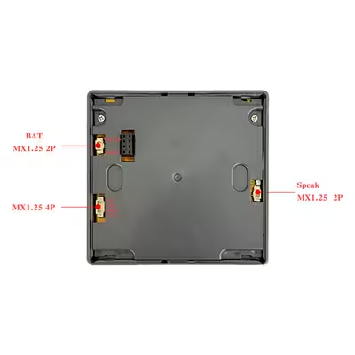

# ESP32-4848S040C_I — HA Panel

Panel dotykowy Home Assistant na płytce **Guition ESP32-S3-4848S040C_I**
(4" IPS 480×480, ST7701S, dotyk GT911, 3 przekaźniki), zbudowany w **ESPHome + LVGL**.
Panel steruje czterema gniazdkami z pomiarem energii, pokazuje odczyty terrarium,
pogodę i steruje dwoma odtwarzaczami multimedialnymi.

## Spis treści

1. [Wymagania](#wymagania)
2. [Narzędzia Python (build / deploy / zarządzanie)](#narzędzia-python-build--deploy--zarządzanie)
3. [Konfiguracja i sekrety](#konfiguracja-i-sekrety)
4. [Budowanie i wgrywanie](#budowanie-i-wgrywanie)
5. [Czujniki i encje](#czujniki-i-encje)
6. [Interfejs na ekranie](#interfejs-na-ekranie)
7. [Bezpieczeństwo](#bezpieczeństwo)
8. [Struktura repozytorium](#struktura-repozytorium)
9. [Uwagi sprzętowe i zasoby](#uwagi-sprzętowe-i-zasoby)

## Wymagania

- Windows 11 (projekt rozwijany lokalnie, płytka podpięta przez USB), Python 3.13
- Home Assistant z włączonym natywnym API ESPHome (integracja ESPHome)
- Płytka Guition ESP32-S3-4848S040C_I (szczegóły: [cloud.MD](cloud.MD))
- Dostęp do internetu podczas budowania (ESPHome pobiera czcionki MDI z GitHuba i Roboto z Google Fonts)

## Narzędzia Python (build / deploy / zarządzanie)

Projekt **nie zawiera własnych skryptów** do wdrażania. Całość opiera się na pakietach Pythona
zainstalowanych w lokalnym wirtualnym środowisku `.venv` (katalog jest w `.gitignore`).
Wersje są przypięte w [`requirements.txt`](requirements.txt).

| Pakiet | Do czego służy |
|--------|----------------|
| `esphome` | Kompilacja YAML → firmware, flashowanie przez USB, aktualizacje OTA, podgląd logów (`esphome.exe`) |
| `platformio` | Toolchain, z którego korzysta ESPHome (pobiera framework ESP-IDF do `.esphome/`) |
| `esptool` | Niskopoziomowe operacje na układzie: odczyt info, wymazanie flasha, ręczny zapis binarki |
| `aioesphomeapi` | Klient natywnego API ESPHome: `aioesphomeapi-logs` (logi po sieci), `aioesphomeapi-discover` (wykrywanie urządzeń) |
| `mcp` + `openocd-mcp` | Opcjonalne: debug JTAG (flash, halt, breakpointy) z poziomu Claude Code; wymaga zainstalowanego OpenOCD |

### Tworzenie środowiska

```powershell
python -m venv .venv
.venv\Scripts\python.exe -m pip install --upgrade pip
.venv\Scripts\python.exe -m pip install -r requirements.txt
```

Pakiety instaluj zawsze przez `.venv\Scripts\python.exe -m pip`, aby nie mieszać ich z globalnym Pythonem.
Po instalacji komendy są dostępne jako `.venv\Scripts\esphome.exe`, `.venv\Scripts\esptool.exe` itd.
(lub po aktywacji: `.venv\Scripts\Activate.ps1`).

### Opcjonalnie: debug przez MCP (Claude Code)

Lokalny plik `.claude/settings.json` (poza repozytorium, bo zawiera ścieżki bezwzględne) rejestruje
serwer `openocd-mcp` z `.venv\Scripts\openocd-mcp.exe`. Wzór:

```json
{
  "mcpServers": {
    "openocd": {
      "command": "<ścieżka-do-projektu>\\.venv\\Scripts\\openocd-mcp.exe",
      "args": []
    }
  }
}
```

## Konfiguracja i sekrety

1. Skopiuj `secrets.yaml.example` do `secrets.yaml` i uzupełnij własne wartości
   (plik jest w `.gitignore` — **nigdy go nie commituj**).
2. Klucz szyfrowania API wygeneruj samodzielnie, np.: `openssl rand -base64 32`
   (ten sam klucz podajesz w Home Assistant przy dodawaniu urządzenia).
3. W `ha-panel.yaml` dostosuj do swojej instalacji:
   - sekcję `substitutions` (odtwarzacze, encja pogody),
   - identyfikatory encji `switch.*` i `sensor.*` (patrz [Czujniki i encje](#czujniki-i-encje)).

| Klucz w `secrets.yaml` | Znaczenie |
|------------------------|-----------|
| `wifi_ssid`, `wifi_password` | Dane sieci Wi-Fi 2.4 GHz |
| `api_encryption_key` | Klucz szyfrowania natywnego API (base64, 32 bajty) |
| `ota_password` | Hasło aktualizacji OTA |
| `ap_fallback_password` | Hasło awaryjnego access pointu (min. 8 znaków) |

## Budowanie i wgrywanie

Polecenia uruchamiaj w katalogu projektu (z aktywnym `.venv` lub przez pełną ścieżkę do `.exe`).

```powershell
# walidacja konfiguracji
.venv\Scripts\esphome.exe config ha-panel.yaml

# kompilacja bez wgrywania
.venv\Scripts\esphome.exe compile ha-panel.yaml

# pierwszy raz: wgranie przez USB (wybierz port COM)
.venv\Scripts\esphome.exe run ha-panel.yaml --device COMx

# kolejne wersje: OTA po sieci (wybierz urządzenie sieciowe)
.venv\Scripts\esphome.exe run ha-panel.yaml

# logi po USB lub sieci
.venv\Scripts\esphome.exe logs ha-panel.yaml

# wykrywanie urządzeń ESPHome w sieci
.venv\Scripts\aioesphomeapi-discover.exe
```

Pierwsza kompilacja trwa kilka minut (pobieranie toolchaina do `.esphome/`), kolejne są szybsze.
Przed wgraniem OTA ekran jest wygaszany (`light.turn_off` w `ota.on_begin`).

Diagnostyka awaryjna przez `esptool` (`COMx` to port płytki):

```powershell
.venv\Scripts\esptool.exe --port COMx chip-id
.venv\Scripts\esptool.exe --port COMx erase-flash   # czyści cały flash
```

## Czujniki i encje

Wszystkie odczyty są pobierane z Home Assistanta przez natywne API (`platform: homeassistant`,
`internal: true` — nie są duplikowane w HA). Wartości wyświetla LVGL na odpowiednich stronach.
Encje podane poniżej to **przykłady z mojej instalacji — zamień na własne**.

### Gniazdka z pomiarem energii

| Lokalizacja | Przełącznik | Moc (W) | Energia (kWh) |
|-------------|-------------|---------|---------------|
| Salon | `switch.gnizdo_rybki_salon` | `sensor.gnizdo_rybki_salon_power` | `sensor.gnizdo_rybki_salon_energy` |
| Sypialnia | `switch.gniazdo16w` | `sensor.gniazdo16w_power` | `sensor.gniazdo16w_energy` |
| Kuchnia | `switch.gniazdo20w` | `sensor.gniazdo20w_power` | `sensor.gniazdo20w_energy` |
| Terrarium | `switch.gniazdo6_20w` | `sensor.gniazdo6_20w_power` | — |

- Moc jest przycinana filtrem `clamp` do zakresu 0–200 W i pokazywana jako etykieta oraz pasek postępu
  (wartość × 0,5 → skala 0–100).
- Energia jest wyświetlana w kWh z jednym miejscem po przecinku.

### Terrarium (czujnik temperatury i wilgotności)

| Odczyt | Encja | Format |
|--------|-------|--------|
| Temperatura | `sensor.kanciapatemp_temperature` | `23.5 C` |
| Wilgotność | `sensor.kanciapatemp_humidity` | `45 %` |

### Multimedia

Encje odtwarzaczy ustawiasz w `substitutions` (`salon_player`, `sypialnia_player`):

| Atrybut | Wykorzystanie |
|---------|---------------|
| stan (`playing` / inne) | Ikona play/pauza, animowany equalizer i podświetlona ramka karty |
| `media_title` | Tytuł utworu (lub „Brak odtwarzania”) |
| `volume_level` | Pasek głośności (0–100%) |

Przyciski wywołują usługi: `media_player.media_play_pause`, `media_previous_track`,
`media_next_track`, `volume_up`, `volume_down`.

### Pogoda i czas

- Encja pogody (`weather_entity`): stan → ikona MDI i polski opis (np. „Słonecznie”, „Ulewa”),
  atrybut `temperature` → temperatura.
- Czas pochodzi z Home Assistanta (`time: homeassistant`), zegar odświeżany co minutę.

### Diagnostyka (widoczna w HA)

| Czujnik | Opis |
|---------|------|
| `Debug Wolny heap`, `Debug Najwiekszy blok heap` | Pamięć sterty |
| `Debug Wolny PSRAM` | Wolny PSRAM |
| `Debug Czas petli` | Czas pętli głównej |
| `Debug Uptime` | Czas pracy |
| `Debug WiFi RSSI` | Siła sygnału Wi-Fi |

Dodatkowo encja `Backlight` (światło) pozwala sterować podświetleniem z HA.

## Interfejs na ekranie

Ekran 480×480, ciemny motyw, grafika LVGL. Na dole stały pasek nawigacji z pięcioma przyciskami
(ikony MDI). Po 60 s bezczynności panel przechodzi w wygaszacz (można wyłączyć w Ustawieniach).

| Strona | Zawartość |
|--------|-----------|
| **Zegar** (główna) | Gradientowe tło, kapsułki „Razem W” i „Gniazdka x/4”, data po polsku, zegar 140 px, kapsułka statusu (czerwona gdy temperatura terrarium poza zakresem), cztery bąbelki (pogoda, wiatr, wilgotność zewn., terrarium) i skróty do czterech gniazdek |
| **Multimedia** | Dwie karty odtwarzaczy (Salon, Sypialnia): tytuł, sterowanie, głośność, animowany equalizer |
| **Energia** | Kafelki 2×2: Salon, Sypialnia, Kuchnia (łuk mocy 0–200 W, przełącznik, kWh) oraz „Razem” |
| **Terrarium** | Przełącznik gniazdka, moc, wskaźniki łukowe temperatury i wilgotności, zakres docelowy (`terrarium_temp_min/max` w `substitutions`) |
| **Ustawienia** | Suwak jasności 5–100%, przełącznik wygaszacza, adres IP i wersja panelu |
| **Wygaszacz** | Przyciemniony zegar (5% jasności) przesuwany co minutę, dotknięcie budzi ekran |

Poprzednia wersja ekranów (v1: zegar + multimedia, Akwaria, Terrarium, Ustawienia) jest pod tagiem `screens-v1`:
`git checkout screens-v1 -- ha-panel.yaml`.

Sposób prezentacji:

- **Kolor akcentu na lokalizację**: Salon — cyjan `0x4FC3F7`, Sypialnia — fiolet `0xB388FF`,
  Kuchnia — bursztyn `0xFFB74D`, Terrarium — zielony `0x66BB6A`.
- **Stan włączenia**: karta z włączonym gniazdkiem/odtwarzaczem dostaje kolorową ramkę (2 px)
  i pierścień; wyłączona — neutralną ramkę (1 px, `0x2C3858`).
- **Dwukierunkowość**: dotknięcie przełącznika wywołuje `switch.turn_on/turn_off` w HA, a zmiana stanu
  z HA aktualizuje przełącznik na ekranie.
- **Ikony**: czcionka Material Design Icons (podzbiór glifów w kilku rozmiarach), tekst: Roboto.
- **Equalizer**: cztery słupki animowane `lv_anim` z różnymi czasami, aktywne tylko podczas odtwarzania.

## Bezpieczeństwo

- Wszystkie hasła i klucze trafiają do `secrets.yaml` (ignorowany przez git) i są wczytywane przez `!secret`.
  W repozytorium znajduje się wyłącznie szablon `secrets.yaml.example` z wartościami zastępczymi.
- Lokalny plik `.env` (dane dostępowe do HA/Wi-Fi) oraz `.claude/` są w `.gitignore`.
  Nie są potrzebne do zbudowania firmware.
- Komunikacja z HA jest szyfrowana (`api.encryption`), a OTA chronione hasłem.
- Przed publikacją zmian sprawdź, czy w commitach nie ma sekretów, adresów IP ani tokenów:
  `git diff --cached` oraz `git ls-files`.
- Jeśli sekret kiedykolwiek trafił do historii git, **zmień go** (rotacja klucza API/hasła/tokenu) —
  samo usunięcie pliku z kolejnego commita nie wystarcza.

## Struktura repozytorium

| Plik | Opis |
|------|------|
| `ha-panel.yaml` | Główna konfiguracja ESPHome (wyświetlacz, dotyk, czujniki HA, skrypty, LVGL) |
| `secrets.yaml.example` | Szablon sekretów |
| `requirements.txt` | Przypięte wersje narzędzi Pythona |
| `cloud.MD` | Specyfikacja sprzętu i mapa pinów |
| `LICENSE` | MIT |

Nie są wersjonowane: `secrets.yaml`, `.env`, `.claude/`, `.venv/`, `.esphome/`.

## Uwagi sprzętowe i zasoby

- Inicjalizacja ST7701S musi być typu 9, inaczej ekran pozostaje czarny.
- GPIO 33–37 zajęte przez Octal PSRAM; SD i LCD współdzielą GPIO 47/48.
- GPIO 0 i 3 to piny strappingowe użyte w magistrali RGB.

### Tył płytki i złącza



Źródło zdjęcia: [displaysmodule.com](https://www.displaysmodule.com/photo/py200569774-experience_superior_display_performance_with_esp32_display_module_480_480_resolution_and_86_5_86_5_37_8_mm_size.jpg).

| Złącze | Opis na zdjęciu |
|--------|-----------------|
| `BAT` | MX1.25 2P — zasilanie bateryjne |
| bez nazwy | MX1.25 4P — złącze rozszerzeń (do potwierdzenia: piny i napięcie) |
| `Speak` | MX1.25 2P — wyjście na głośnik, więc płytka ma wzmacniacz audio |
| nagłówek 2×4 | wyprowadzenia środka płytki (do potwierdzenia) |

Zdjęcie nie opisuje pinów. Przed podłączeniem mikrofonu sprawdź piny multimetrem
albo na schemacie producenta.

Zasoby:
[ESPHome device page](https://devices.esphome.io/devices/guition-esp32-s3-4848s040) ·
[NorthernMan54/ESP32-4848S040](https://github.com/NorthernMan54/ESP32-4848S040) ·
[atomic14 – gotchas](https://www.atomic14.com/esp32/boards/guition-4848s040/)

## Licencja

MIT — zobacz [LICENSE](LICENSE).
